<p align="center">
  
</p>

<h1 align="center">Renacer Vikingo</h1>

<p align="center">
  <em>Un RPG 2D vikingo sobre reconstruir una aldea arrasada por los Cruzados.</em>
</p>

<p align="center">
  
  
  
  
  
</p>

---

## Índice

- [Historia](#historia)
- [Cómo se juega](#cómo-se-juega)
- [Controles](#controles)
- [Mecánicas](#mecánicas)
  - [Vida, energía y experiencia](#vida-energía-y-experiencia)
  - [Combate](#combate)
  - [Construcciones y misiones](#construcciones-y-misiones)
  - [Comercio](#comercio)
  - [Huerto](#huerto)
  - [Ciclo de día y noche](#ciclo-de-día-y-noche)
- [Mapa y zonas](#mapa-y-zonas)
- [Recorrido del juego](#recorrido-del-juego)
- [Interfaz](#interfaz)
- [Personajes](#personajes)
  - [Hákon, el protagonista](#hákon-el-protagonista)
  - [Habitantes de la aldea](#habitantes-de-la-aldea)
  - [Los Cruzados](#los-cruzados)
- [Arte y animación](#arte-y-animación)
- [Audio](#audio)
- [Estructura del proyecto](#estructura-del-proyecto)
- [Cómo ejecutarlo](#cómo-ejecutarlo)
- [Estado del proyecto](#estado-del-proyecto)
- [Equipo](#equipo)

---

## Historia

Noruega, una época de tumulto. Los vikingos vivían en paz bajo el gobierno del **Konungr Ragnar** y su familia, hasta que los **Cruzados** —liderados por el ambicioso **Barón Conrad**— invaden su tierra dispuestos a aplastar toda resistencia.

El asedio arrasa la aldea: caen el Konungr y su familia, y los edificios quedan reducidos a cenizas. En medio del caos surge un humilde **Karl** —un hombre libre— que presencia la devastación y decide tomar las riendas del destino de su pueblo.

El jugador encarna a ese Karl. Su misión es **reconstruir las estructuras devastadas** y devolver la esperanza a los aldeanos. Empieza con tareas sencillas: recolectar recursos, reparar lo que quedó en pie. A medida que demuestra su valía, se gana la confianza de los demás Karls y de los Jarls, escala en la sociedad vikinga —de **Thrall** a **Konungr**— y asume desafíos mayores: los ataques de los Cruzados, el entrenamiento de los aldeanos para la defensa, y finalmente devolver a su pueblo su antigua gloria.

La historia se cuenta con una **cinemática de apertura** en cinco láminas, que van de la aldea en paz a la invasión y a la decisión del protagonista:

<table>
<tr>
<td width="50%">
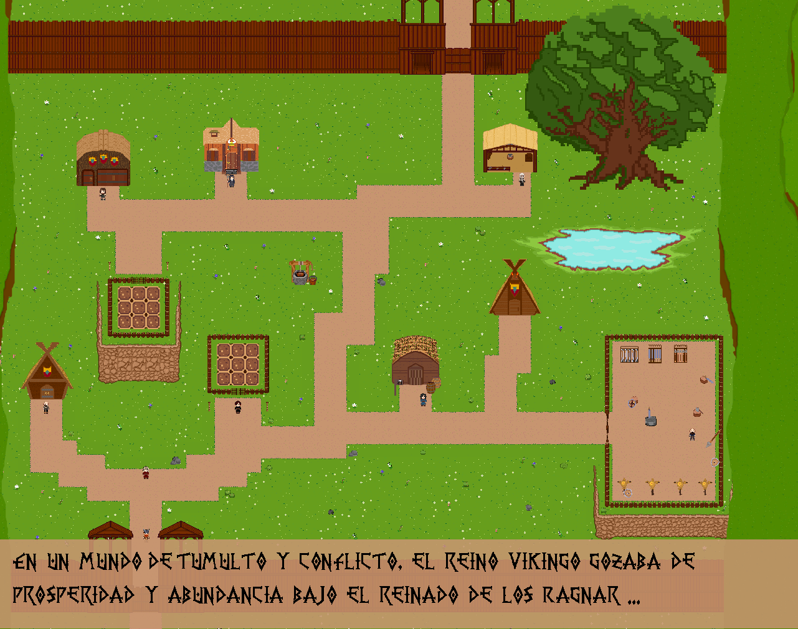<br>
<sub><i>«En un mundo de tumulto y conflicto, el reino vikingo gozaba de prosperidad y abundancia bajo el reinado de Ragnar…»</i></sub>
</td>
<td width="50%">
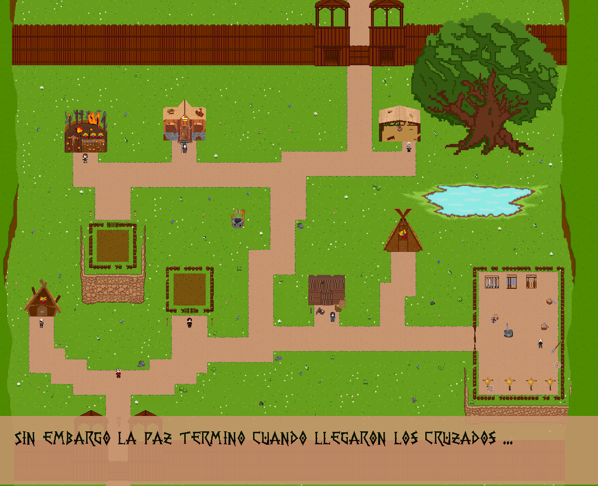<br>
<sub><i>«Sin embargo, la paz terminó cuando llegaron los Cruzados…»</i></sub>
</td>
</tr>
<tr>
<td>
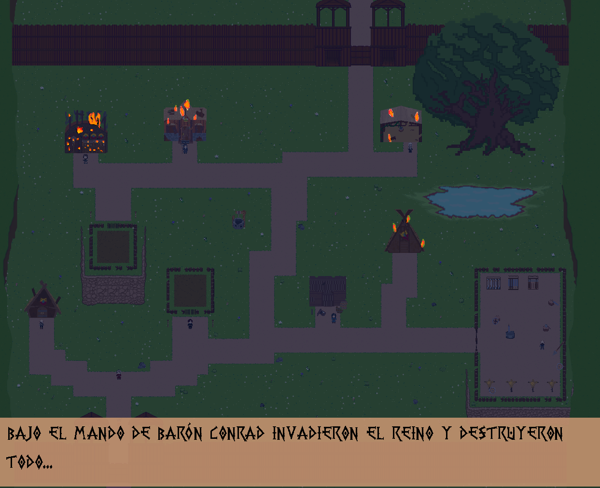<br>
<sub><i>«Bajo el mando del Barón Conrad invadieron el reino y destruyeron todo…»</i></sub>
</td>
<td>
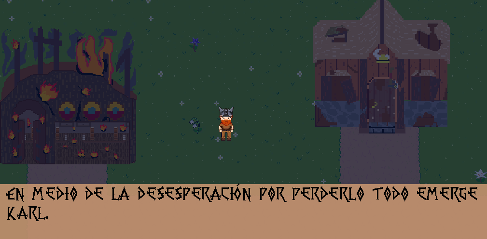<br>
<sub><i>«En medio de la desesperación por perderlo todo emerge Karl.»</i></sub>
</td>
</tr>
</table>

<p align="center">
  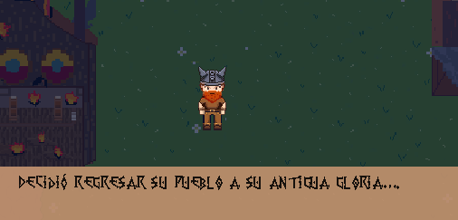<br>
  <sub><i>«Decidió regresar su pueblo a su antigua gloria…»</i></sub>
</p>

---

## Cómo se juega

*Renacer Vikingo* es un **RPG de exploración 2D con vista cenital**. El bucle principal combina tres cosas:

1. **Recolectar** madera en el bosque, piedra y hierro en la cueva.
2. **Reconstruir** los edificios de la aldea con esos materiales, siguiendo las misiones del sabio.
3. **Defenderse** de los Cruzados que aparecen por las zonas, subiendo de nivel y comprando mejores armas.

La aldea está rodeada por una muralla con dos puertas: **la de abajo lleva al bosque y la de arriba a la mina**. Desde ahí el jugador sale a buscar recursos en cualquier momento, o vuelve a los interiores para comerciar y hablar con los aldeanos.

---

## Controles

| Acción | Tecla |
| --- | --- |
| Mover | `W` `A` `S` `D` o flechas |
| Interactuar (entrar, hablar, construir) | `F` |
| Avanzar diálogo | `Espacio` |
| Pausa | `Esc` o `P` |
| Reaparecer tras morir | `R` |

El **sprint** se activa con `Shift`: da velocidad extra durante 5 segundos, y luego entra en un tiempo de recuperación de 10 segundos.

---

## Mecánicas

### Vida, energía y experiencia

El jugador arranca con **100 puntos de vida**. Cada golpe de un Cruzado le quita 5 puntos.

La energía va de **0 a 100** y se recupera comiendo lo que se cosecha en el huerto:

| Alimento | Energía |
| --- | --- |
| Zanahoria | 5 |
| Cebolla | 4 |
| Repollo | 3 |
| Remolacha | 2 |

La salud se recupera con la **cantimplora** (+10 de vida). Cuando se vacía hay que rellenarla en la taberna.

El sistema de niveles usa la fórmula:

```
expRequerida = expBase × valorIncremental^(nivel − 1)
```

Con `expBase = 100` y `valorIncremental = 1.5`, subir de nivel cuesta cada vez más. El nivel otorga un rango dentro de la sociedad vikinga:

| Nivel | Rango |
| --- | --- |
| 1 | Thrall |
| 2 | Karl |
| 3 | Hersir |
| 4 | Jarl |
| 5 | Konungr |

Al subir se reparten puntos entre **Fuerza**, **Inteligencia** y **Destreza**, que modifican el daño, la defensa, el bloqueo y la velocidad del personaje.

### Combate

El jugador empieza con la **alcotana**, un arma de doble uso: sirve de hacha para talar y de pico para minar, aunque con menos eficiencia que las herramientas especializadas. La espada, el hacha y el pico se compran en la herrería.

Al morir, el jugador reaparece en el punto de inicio y **pierde todo lo recolectado** salvo la alcotana.

Los enemigos tienen 100 de vida y hacen distinto daño según su tipo:

| Enemigo | Daño por golpe | Recompensa (monedas / XP) |
| --- | --- | --- |
| Infantería | 5 | 5 / 5 |
| Caballero | 10 | 10 / 10 |
| Comandante | 15 | 15 / 15 |

Aparecen de forma aleatoria, solos o en grupos de hasta 4.

### Construcciones y misiones

El **viejo sabio Asmund**, frente al salón comunal, asigna las misiones de reconstrucción. Cada edificio pide materiales concretos y da una recompensa en monedas:

| Edificio | Materiales | Recompensa |
| --- | --- | --- |
| Pozo | 10 madera, 10 piedra | — |
| Huerto | 1 balde de agua, 100 madera, 4 semillas | 20 |
| Herrería | 60 madera, 50 piedra | 100 |
| Almacén | 200 madera, 50 piedra, 150 hierro | 50 |
| Taberna | 4 baldes de agua, 100 madera, 100 piedra, 20 remolachas | 80 |
| Cabañas | 100 madera, 50 piedra, 10 hierro | 50 |
| Campo de entrenamiento | 80 madera, 60 piedra, 20 hierro | 50 |
| Salón comunal | 300 madera, 100 piedra, 100 hierro | 100 |

Al reunir todo, se presiona `F` frente al edificio y comienza la reparación.

También hay **misiones secundarias** de los aldeanos: derrotar cierta cantidad de enemigos (10 infantería, 8 caballeros, 5 comandantes) o reunir recursos (20 madera y 20 piedra, o 30 de hierro), con recompensas en monedas y materiales.

### Comercio

- **Herrería** (Bjorn): hacha 5 monedas, pico 10, espada 50.
- **Taberna** (Freya): rellenar la cantimplora, 5 monedas.
- **Almacén** (Helga): compra y venta de materiales y provisiones.

### Huerto

El huerto funciona por ciclos de cosecha de 10 minutos. Se siembra con el clic izquierdo (menú de verduras, seleccionar y "cultivar") y se recoge caminando sobre el cultivo. Cada cosecha da 9 unidades de la verdura elegida: zanahoria, remolacha, repollo o cebolla.

### Ciclo de día y noche

El mundo tiene un ciclo de **día y noche** con sol y luna que se refleja en el HUD. La iluminación cambia de amanecer a mediodía y a noche, y hay objetos interactivos (antorchas) que se encienden en la oscuridad.

---

## Mapa y zonas

<p align="center">
  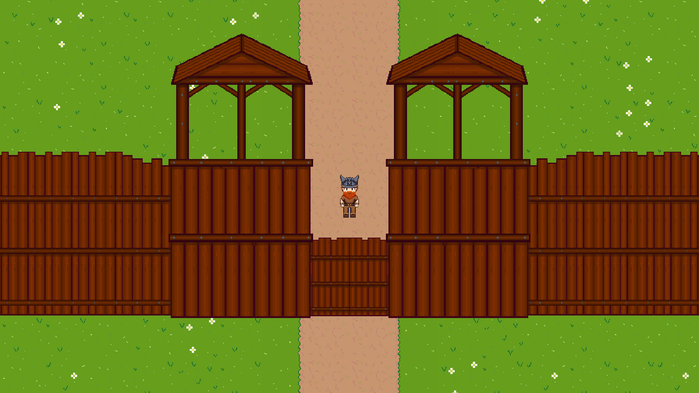<br>
  <sub>La aldea amurallada, reconstruida. La muralla tiene dos puertas: abajo el bosque, arriba la mina.</sub>
</p>

El juego tiene **12 escenas jugables** repartidas en cuatro grupos:

| Zona | Escenas |
| --- | --- |
| **Aldea** | `LevelDestruido` (estado inicial tras la invasión), `LevelConstruido` (reconstruida), `CinematicaConstruido` |
| **Mundos exteriores** | `Bosque`, `Mina`, `CuevaPasillo` (pasillo interior, se carga sobre la mina) |
| **Interiores** | `Almacen`, `Herreria`, `SalonComunal`, `Taberna` |
| **Interfaz** | `Menu`, `Manual` (libro tutorial), `Cinematica` |

<table>
<tr>
<td width="50%">
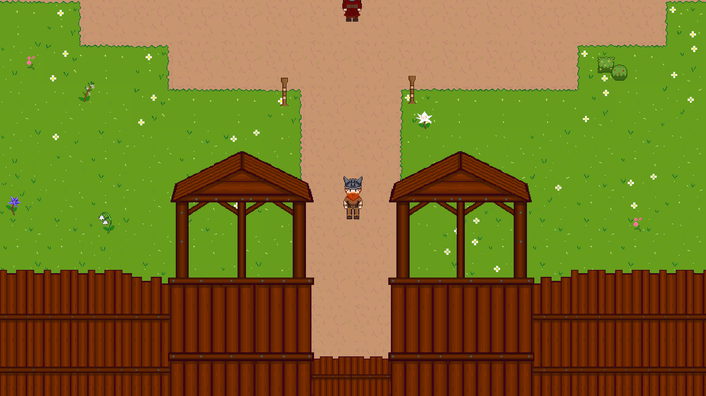<br>
<sub><b>LevelDestruido</b> — la aldea tal como queda tras el paso de los Cruzados.</sub>
</td>
<td width="50%">
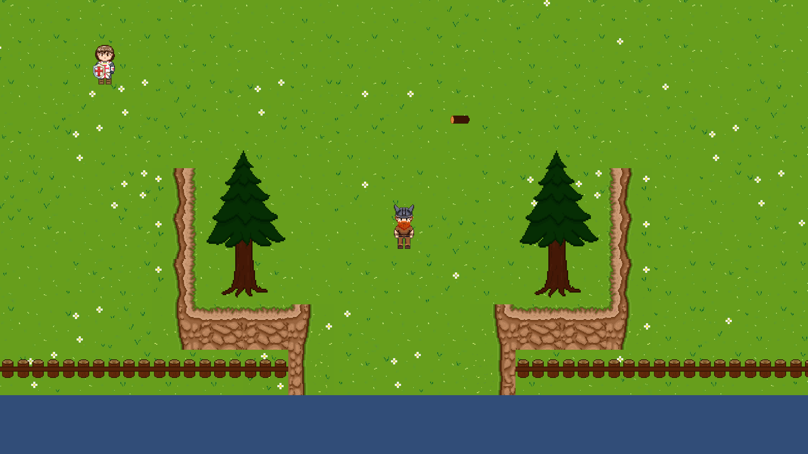<br>
<sub><b>Bosque</b> — zona de tala. Se recogen troncos pasando por encima.</sub>
</td>
</tr>
<tr>
<td>
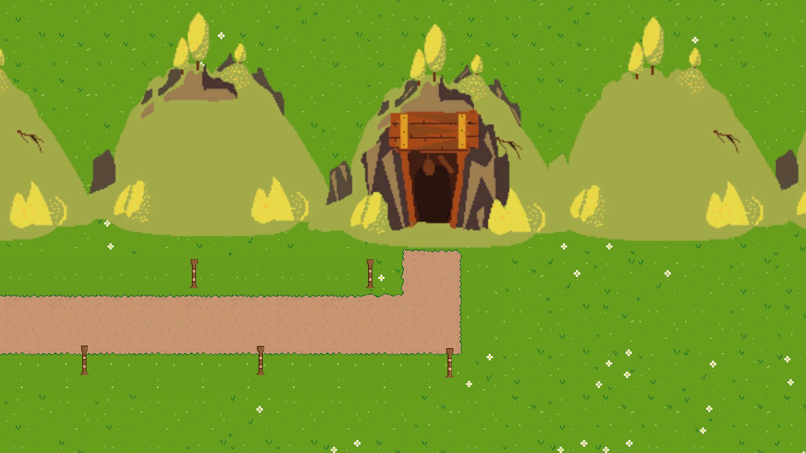<br>
<sub><b>Mina</b> — entrada a la cueva, zona de piedra y hierro.</sub>
</td>
<td>
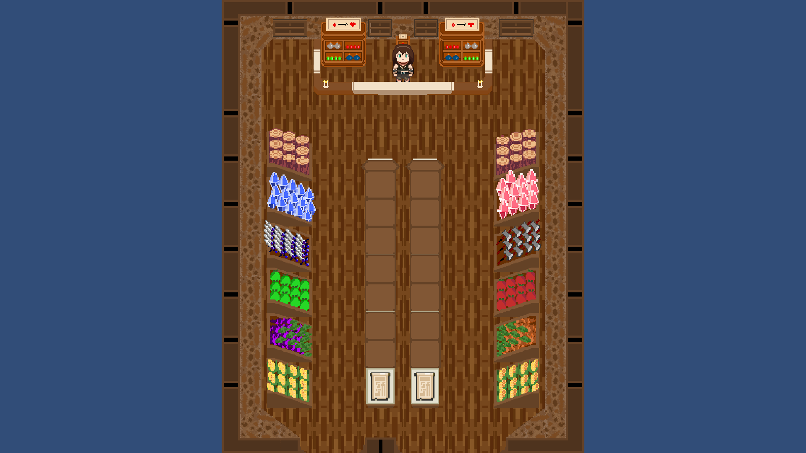<br>
<sub><b>Almacén</b> — interior. Helga atiende el mostrador y las estanterías.</sub>
</td>
</tr>
</table>

<table>
<tr>
<td width="50%">
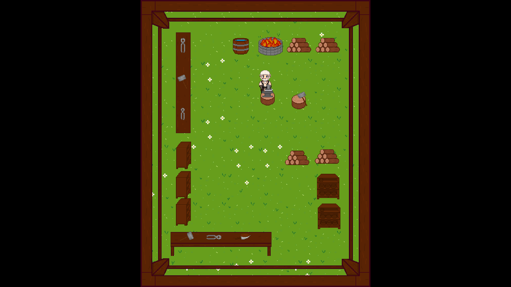<br>
<sub><b>Herrería</b> — la forja, el yunque y el fuelle de Bjorn.</sub>
</td>
<td width="50%">
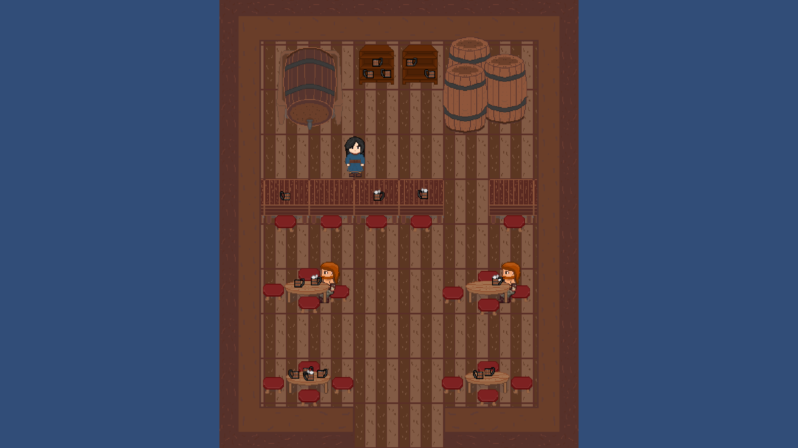<br>
<sub><b>Taberna</b> — mesas, barriles y la barra donde se rellena la cantimplora.</sub>
</td>
</tr>
<tr>
<td>
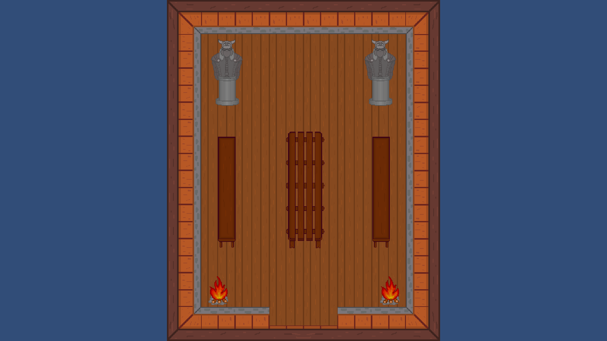<br>
<sub><b>Salón Comunal</b> — estatuas, escudos y donde Asmund reparte las misiones.</sub>
</td>
<td>
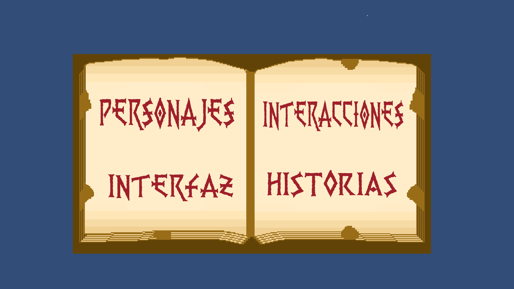<br>
<sub><b>Manual</b> — el libro que explica personajes, interfaz, interacciones e historias.</sub>
</td>
</tr>
</table>

---

## Recorrido del juego

Todo empieza en el **menú principal**, un pergamino que se despliega con los botones *Entrar*, *Ajustes* y *Salir*. Desde *Ajustes* se controlan el brillo y los cuatro volúmenes (general, música, efectos y ambiental).

<p align="center">
  <br>
  <sub>El menú principal, con el pergamino desplegado. Los botones <i>Entrar</i>, <i>Ajustes</i> y <i>Salir</i> quedan por detrás del pergamino — ver <a href="#estado-del-proyecto">Estado del proyecto</a>.</sub>
</p>

Desde *Entrar* se accede al juego, que arranca en la aldea destruida. El flujo previsto, según el guion técnico, es:

1. **Cinemática 1** — un travelling por la aldea en paz.
2. **Cinemática 2** — la llegada de los Cruzados y la destrucción, con *fade to black*.
3. **Tutorial** — el libro del manual.
4. **Misiones de reconstrucción** — Asmund asigna los edificios, uno por uno.
5. **Misiones secundarias** — los aldeanos piden recursos y bajas.
6. **El ascenso** — de Karl a Konungr, con alianzas y defensa contra los Cruzados.

<p align="center">
  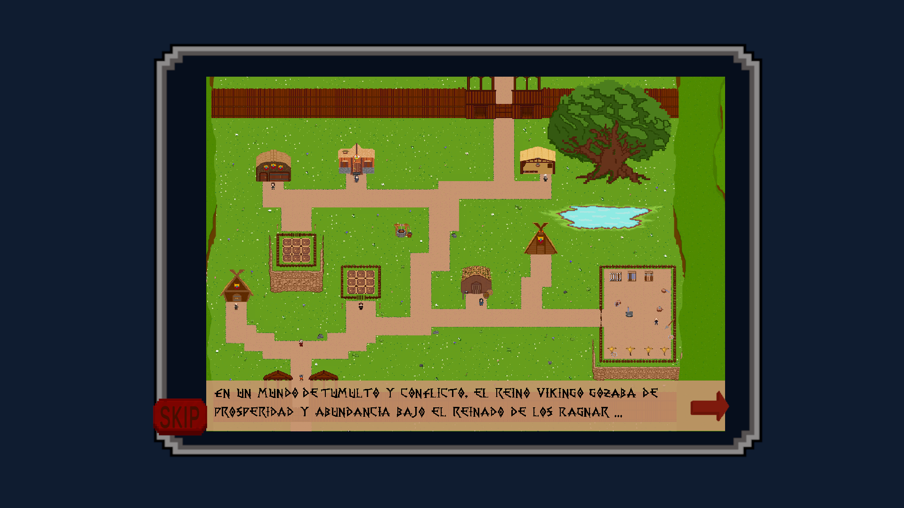<br>
  <sub>La cinemática corriendo en el juego: la primera lámina, con el botón <i>SKIP</i> y la flecha para avanzar.</sub>
</p>

---

## Interfaz

El HUD reúne, de un vistazo:

- Retrato del personaje.
- **Barra de vida** (roja), **experiencia** (verde) y **energía** (azul).
- **Contador de monedas**.
- **Temporizador de día y noche** (sol / luna).

Los paneles principales son: **mochila** (inventario de 24 casillas), **libro** (atributos y estadísticas), **pergamino** (misiones asignadas) y **panel de misiones** (misiones completadas).

El inventario permite **usar**, **equipar** y **remover** objetos. Cada casilla admite 20 unidades y las armas ocupan una casilla cada una.

---

## Personajes

### Hákon, el protagonista

| | |
| --- | --- |
| **Nombre** | Hákon |
| **Edad** | 30 años |
| **Ocupación** | Karl (hombre libre) |
| **Rasgos** | Valor, honor, adaptabilidad, comunitario, religioso, comerciante |
| **Habilidades** | Manejo de armas y recolección |

<p align="center">
  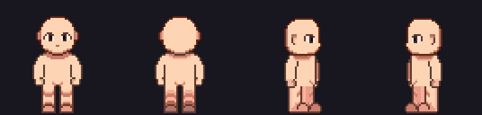<br>
  <sub>Hákon en las cuatro direcciones de caminata.</sub>
</p>

<p align="center">
  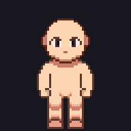
  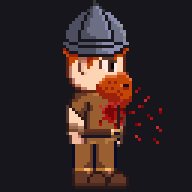
</p>

### Habitantes de la aldea

Ocho aldeanos dan vida al reino. Se interactúa con ellos con `F` y se avanza el diálogo con `Espacio`; cada uno cuenta su historia y su papel en la reconstrucción.

<table>
<tr>
<td align="center">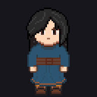<br><b>Freya</b><br><sub>Taberna</sub></td>
<td align="center">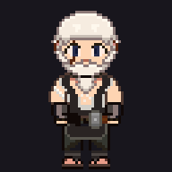<br><b>Bjorn</b><br><sub>Herrero</sub></td>
<td align="center">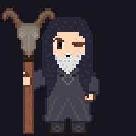<br><b>Asmund</b><br><sub>Sabio</sub></td>
<td align="center">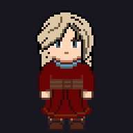<br><b>Thora</b><br><sub>Introducción</sub></td>
</tr>
<tr>
<td align="center">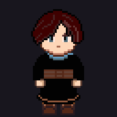<br><b>Astrid</b><br><sub>Huerto</sub></td>
<td align="center">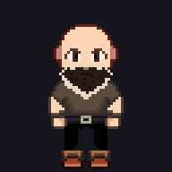<br><b>Harald</b><br><sub>Cabaña</sub></td>
<td align="center">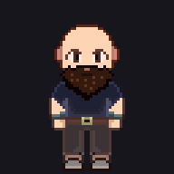<br><b>Sigurd</b><br><sub>Entrenamiento</sub></td>
<td align="center">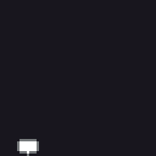<br><b>Comensal</b><br><sub>Taberna</sub></td>
</tr>
</table>

### Los Cruzados

Los enemigos son tres rangos de la misma fuerza invasora, cada uno con más aguante y más daño:

<table>
<tr>
<td align="center" width="33%">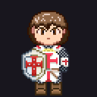<br><b>Infantería</b><br><sub>Cota de malla y escudo</sub></td>
<td align="center" width="33%">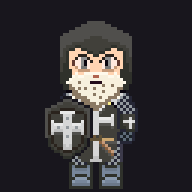<br><b>Caballero</b><br><sub>Añade casco</sub></td>
<td align="center" width="33%">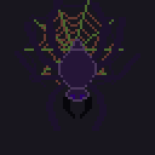<br><b>Araña</b><br><sub>Guardiana de la cueva</sub></td>
</tr>
</table>

Su comportamiento está montado con un sistema de estados: patrullan siguiendo un camino predefinido y, si el jugador entra en su rango de detección, pasan a perseguirlo y a atacar.

---

## Arte y animación

Todo el arte es **pixel art 2D**, con sprites de personajes animados a **64 × 64** en cuatro direcciones. Los personajes están construidos con capas separadas (cuerpo, ropa, armas), lo que permite cambiar la apariencia sin repintar la animación: en el proyecto conviven las versiones de Hákon **con ropa** y **vestido**, con animaciones de *idle*, *caminar*, *ataque* y *muerte* para cada una.

<p align="center">
  
</p>

El mapa se compone con **tiles** de suelos (pasto, tierra, camino), y sobre ellos se colocan prefabs de vegetación, rocas, edificios y mobiliario. Cada edificio existe en dos estados —**en pie** y **destruido**— para representar el antes y el después de la invasión.

---

## Audio

El juego usa un **AudioMixer** con cuatro canales independientes: general, música, efectos y ambiental. La banda sonora es de ambientación nórdica, y hay grupos de sonido específicos definidos por zona:

- **Ambientación**: bosque, cueva (goteo, murciélagos), aldea.
- **Pasos**: por tipo de terreno — tierra, bosque, cueva, interior de madera.
- **Acciones**: talar, minar, atacar con espada o hacha, morir.
- **Interfaz**: botones, pergamino, sonidos de menú.

---

## Estructura del proyecto

```
vikingo/
├── Docs/                    Documentación de diseño (.docx, .xlsx)
├── docs/img/                Capturas y GIFs que usa este README
├── tools/make_gifs.py       Script que genera los GIFs desde las hojas de sprites
└── Vikingo/                 Proyecto de Unity
    ├── Assets/
    │   ├── Scenes/          Escenas por zona (Exterior, Interiores, Interfaz, Pruebas)
    │   ├── Scripts/         Código en C# (ver abajo)
    │   ├── AI/              Sistema de IA de enemigos (acciones, decisiones, estados)
    │   ├── Animaciones/     Animators y clips (.anim, .controller)
    │   ├── Prefab/          Prefabs de edificios, mobiliario, ítems y personajes
    │   ├── Sprites/         Todo el arte 2D (personajes, mapa, UI, ítems)
    │   ├── Scriptable  Objectd/  Datos: ítems, armas, quests, diálogos, semillas
    │   ├── Audio/           Música, SFX y el AudioMixer
    │   └── Timeline/        Secuencias de cinemática
    ├── Packages/            Dependencias (URP, TMP, Timeline, 2D…)
    └── ProjectSettings/     Configuración del proyecto
```

Los **72 scripts** de `Assets/Scripts` están agrupados por sistema: `Personaje` (vida, maná, ataque, experiencia, estadísticas), `Inventario`, `Quests`, `NPC` (movimiento, diálogo, waypoints), `Tienda`, `Farming`, `Armas`, `Día y Noche`, `Managers`, `Interfaz` y `Extras` (singleton, pooling, animación de texto).

El sistema de IA de `Assets/AI` está diseñado con **ScriptableObjects**: cada acción, decisión y estado es un asset reutilizable que se combina para formar el comportamiento de cada enemigo.

---

## Cómo ejecutarlo

1. Instala **Unity 2021.3.37f1** (LTS) con el módulo de Windows Build Support.
2. Abre la carpeta `Vikingo/` con Unity Hub.
3. Espera a que importen los assets y compilen los scripts.
4. Abre la escena **`Assets/Scenes/Interfaz/Menu.unity`**.
5. Pulsa **Play**.

En el editor, el juego arranca siempre desde el menú; la escena está marcada como primera en *Build Settings* junto con el resto de zonas jugables.

---

## Estado del proyecto

Este es un **proyecto académico** del programa *Desarrollo de videojuegos y entornos interactivos*, desarrollado entre junio y octubre de 2024. Conviene ser claro sobre lo que hay terminado y lo que quedó a medias, porque el material de diseño describe un juego bastante más grande que lo que quedó implementado.

**Lo que está implementado:**

- El menú principal con sus ajustes de brillo y volumen.
- El desplazamiento del personaje en cuatro direcciones, con sprint.
- El combate cuerpo a cuerpo contra los tres tipos de enemigo, con daño, muerte y reaparición.
- El sistema de vida, energía, experiencia, niveles, rangos y reparto de atributos.
- El inventario con uso, equipamiento y descarte de objetos.
- El comercio en la herrería, la taberna y el almacén.
- El huerto con siembra y cosecha por ciclos.
- Las zonas de recolección: el bosque (madera) y la mina y la cueva (piedra y hierro).
- El ciclo de día y noche.
- Las misiones, principales y secundarias, con sus paneles.
- Las doce escenas del mapa, con arte de la aldea en estado construido y destruido.
- El libro tutorial y las cinemáticas.

**Lo que quedó incompleto o con problemas conocidos:**

- **Los botones del menú principal quedan ocultos detrás del pergamino.** El panel con *Entrar*, *Ajustes* y *Salir* existe y es funcional, pero está posicionado por detrás del sprite del pergamino, así que no se ve salvo que se oculte el pergamino. Hay que corregir el orden de dibujo o la profundidad del panel.
- Las misiones de reconstrucción de edificios con temporizador de 5 minutos están documentadas, pero su verificación en juego requiere recorrer todo el flujo de recolección, que es largo. En las pruebas no se completó el ciclo entero de reconstrucción de un edificio.
- El sistema de IA está construido, pero conviene revisar el equilibrio: la velocidad de ataque documentada (un golpe cada 5 segundos) hace los combates muy lentos.
- Hay material de diseño sin implementar: el sistema de facciones de vikingos contra cruzados a escala de clan, los *Thing* y los *Godar*, y las alianzas entre clanes que aparecen en la historia.

En resumen: **el núcleo jugable está ahí y se puede recorrer de principio a fin**, pero el alcance final es menor que el que describe la documentación de diseño, y quedan bugs visibles —el del menú es el más evidente.

---

## Equipo

Proyecto del departamento de **Diseño y Programación**, ficha 2670466. Ocho integrantes.

**Liderazgo**

- **Brayan León** — *Líder de programación*
- **Diego Estupiñán** — *Líder de arte*

**El equipo**

| Integrante | Área principal | Trabajos concretos |
| --- | --- | --- |
| **Brayan León** | **Programación** y ensamble | Personaje 2D (movimiento y ataque), panel de estadísticas, atributos, inventario, enemigos, ensamble e integración de escenas, apoyo en diseño de personajes |
| **Diego Estupiñán** | **Arte** | Personaje (idle, caminar, ataque, muerte), animaciones de armas (hacha, alcotana, pico, daga y espada), diseño y animación de enemigos, suelos |
| **Stiven** | **Arte** y UI | Logo, interfaz, piso de escenario, taberna, cueva, ensamble, además de NPC y diálogos, y programación de misiones |
| **Jessica León** | Arte y documentación | Guía de seguimiento, cronograma, character sheet, huerto, herrería, murallas, interfaz, montañas |
| **David** | Arte y programación | Salón comunal, mina, programación del huerto, ciclo de día y noche, música |
| **Nicolás** | Arte | Almacén (exterior e interior), cabañas, hierro, botones e iconos, programación del mercader |
| **Camilo** | Arte | Taberna, pozo, campo de entrenamiento, árboles, arbustos, piedras, araña, manual |
| **Richard** | Programación | Enemigos 2D (movimiento y ataque), controlador de animaciones, triggers, misiones, interfaces, lago |

<br>

<p align="center"><sub>Desarrollado con Unity 2021.3.37f1 · URP 2D · 2024</sub></p>
